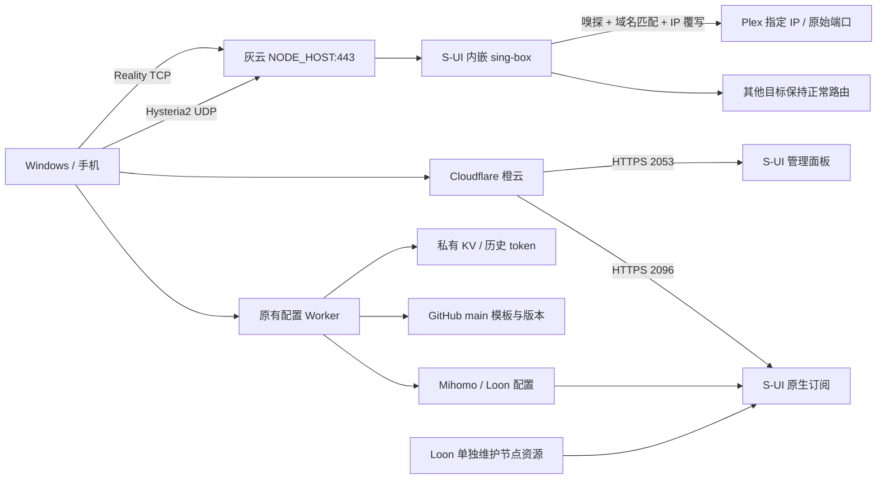

# Primus VPS / S-UI 双节点部署、Plex 定向与订阅整合 SOP

维护基线：2026-10-16。适用于 Debian 13、S-UI 1.6.5、配套 sing-box 1.14.3；Windows 验证客户端为 Clash Verge 2.5.8 / Mihomo 1.19.32。这里记录实际验证过的流程，不保证未来版本字段不变。升级前核对官方发布和迁移说明。

本 SOP 不包含真实订阅、凭据、客户端身份或个人部署地址。先读 [生产基线](../PRODUCTION_BASELINE.md)、[版本文件](../../VERSION.json) 和当前 main；不得用历史附件覆盖当前生产代码。

## A. 架构与参数



Mihomo 使用来源 Provider；Loon 的策略配置与节点资源分离。Worker 不代理 Reality/Hysteria2 的节点连接。不得把面板/订阅域名或 Cloudflare IP 导出为节点服务器地址。

在 VPS 的 root shell 中定义非敏感变量（替换尖括号内容后执行）：

```sh
VPS_IPV4='<new-vps-ipv4>'
BASE_DOMAIN='<example.net>'
NODE_HOST="node.$BASE_DOMAIN"
PANEL_HOST="panel.$BASE_DOMAIN"
SUB_HOST="sub.$BASE_DOMAIN"
WORKER_HOST="config.$BASE_DOMAIN"
REALITY_PORT=443
HYSTERIA2_PORT=443
PANEL_PORT=2053
SUB_PORT=2096
PLEX_DOMAIN='<plex-host.example.net>'
PLEX_TARGET_IP='<plex-origin-ipv4>'
PLEX_PORT=32400
SUI_VERSION=1.6.5
```

私密参数包括面板路径、S-UI 客户端名称/订阅 ID、UUID、HY2 密码、Reality 私钥、Worker token 和第三方订阅 URL。通过用户交互或 root-only 私有文件提供；不要写入 Git、命令行参数、终端录屏或公开日志。面板用户名也由部署参数确定。生产示例节点名称可按资产命名规则替换，迁移同一资产时保持原指定名称。

## B. 环境准备与初检

建议最低 1 vCPU、1GB RAM、10GB 磁盘，具体按并发量和日志增长评估。要求真实可达 IPv4、允许 TCP 22/80/443/2053/2096 与 UDP 443，出站 DNS/HTTPS 正常。先确认用户已完成系统安装；本流程不自动重装系统。

```sh
cat /etc/os-release
uname -m
uname -r
df -h /
ip -4 addr
curl -4fsS https://api.ipify.org; echo
timedatectl
ss -lntup
systemctl status s-ui --no-pager
nft list ruleset
sysctl net.ipv4.tcp_congestion_control
sysctl net.ipv4.tcp_available_congestion_control
sshd -T | grep -E 'permitrootlogin|passwordauthentication|pubkeyauthentication'
```

若发现已有 S-UI、3x-ui、其他代理核心、证书目录或自定义防火墙，切换为“迁移/维护”流程：只读盘点、备份、确认冲突，不运行安装脚本，不覆盖节点。现有 SSH 会话与服务商控制台至少保留一种恢复通道。SSH 密钥登录和普通 sudo 账号需先验证，再考虑关闭 root/密码登录；不能直接照搬加固命令造成失联。

```sh
apt-get update
apt-get install -y ca-certificates curl wget openssl socat cron nftables unzip certbot tcpdump
```

使用系统已选的时间同步服务，避免同时安装多个 NTP daemon。确认 NTP 已同步。实测机器已有 BBR，无需改参数；其他机器如未启用，应核对内核支持、备份 sysctl 配置再调整，并以 `sysctl` 结果验收，不能只凭配置文件判断。

## C. S-UI 安装与持久化配置

仅首次部署可执行。使用官方源，固定版本便于复现；安装脚本本身也从相同 tag 获取。先下载审阅，不使用第三方一键脚本。

```sh
curl -fL "https://raw.githubusercontent.com/alireza0/s-ui/v${SUI_VERSION}/install.sh" -o /root/s-ui-install.sh
less /root/s-ui-install.sh
bash /root/s-ui-install.sh "v$SUI_VERSION"
systemctl enable --now s-ui
/usr/local/s-ui/sui -v
```

官方安装器会校验发布归档校验和。若下载、版本或校验失败，停止，不关闭校验。当前版本把 sing-box 嵌入 S-UI，不假定存在独立 `sing-box.service` 或独立核心二进制；核心重启可在面板进行，整个进程由 `s-ui.service` 管理。

初始化：设置管理用户名、由用户输入密码、面板端口 2053、随机私密路径、订阅端口 2096 和 `/sub/`。首次 HTTPS 登录后用户自行更换正式密码，Agent 不代输或输出密码。

重要位置：

| 项目 | 路径/方式 |
|---|---|
| S-UI 数据库 | `/usr/local/s-ui/db/s-ui.db` |
| systemd 单元 | 安装后用 `systemctl cat s-ui` 核实 |
| 核心基础配置 | 数据库 settings 的 `config`；面板基础信息、DNS、路由列表编辑 |
| 入站/客户端/TLS | 面板对应页面；不要手工编辑临时导出的核心 JSON |
| 一致性备份 | `/usr/local/s-ui/sui backup -output <root-only-path>` |

S-UI 从数据库生成运行配置。优先使用面板正式字段，不能只改临时文件；保存后验证数据库持久化、核心日志和服务重启。当前 `config.route` 支持原生路由动作。

## D. VLESS Reality 节点

1. **TLS 设置 → 添加**：命名 Reality 模板，启用 Reality。
2. SNI 和 Handshake Server 均填 `www.icloud.com`，Handshake Port 填 443，客户端指纹为 Chrome。
3. 使用面板密钥生成按钮生成新密钥对；新 Short ID 可用 `openssl rand -hex 4` 生成（8 个十六进制字符）。私钥只保存在受保护服务端，不发给客户端。
4. **入站管理 → 添加**：VLESS，Listen `::`，本地监听 TCP 443，选择上述 TLS 模板；TCP/RAW，不启用额外传输或复用。
5. 入站的客户端公布地址/多域名配置：`NODE_HOST`、端口 443。不得填 `PANEL_HOST`。
6. **用户管理 → 添加客户端**：新 UUID，关联入站，VLESS Flow 设 `xtls-rprx-vision`。
7. 导出后核对 server、port、uuid、flow、Reality 公钥、Short ID、SNI、Chrome 指纹。

握手目标的 443 是 VPS 向伪装站发起的 TLS 连接端口；本地 443 是客户端向 VPS 接入的监听端口，两者独立。部署前验证目标：

```sh
openssl s_client -connect www.icloud.com:443 -servername www.icloud.com -verify_return_error </dev/null
```

最终必须用客户端真实联网，TLS 探测成功本身不能替代节点验收。

## E. Hysteria2 节点

1. **TLS 设置 → 添加**：独立 HY2 模板，证书/私钥使用下一节的可信证书，SNI 为 `NODE_HOST`；关闭 allow insecure。
2. **入站管理 → 添加**：Hysteria2，Listen `::`，UDP 443，选择该 TLS 模板。
3. 公布地址为 `NODE_HOST:443`，与 Reality 共用域名；TCP/UDP 端口可共存。
4. 为客户端生成新认证密码，关联此入站；可与 Reality 共用一个订阅客户端。
5. 先保留 QUIC 默认参数、未指定带宽的默认行为，不凭经验强制带宽值或拥塞优化。
6. 导出确认 HY2 密码、服务器、端口、SNI，`skip-cert-verify` 为 false 或省略。

网络必须实际允许 UDP 443。浏览器 HTTPS/TCP 探测不能证明 HY2 可用；以真实 HY2 连接、日志和出口 IP 验收。

## F. 服务端 Plex 目标定向

### 选择与配置

单纯 DNS hosts 仅影响由服务端执行的域名解析，不能保证客户端已经解析为 IP 的请求。因此采用 sing-box 原生 **sniff → 精确域名匹配 → route-options.override_address**，仅改目标 IP，保留原端口、HTTP Host 和 TLS SNI。

面板 **路由列表**：保留原有 Sniff、Hijack DNS；在其后、任何可能提前结束路由的规则之前添加：

- 操作：Route Options。
- 规则选项：启用“域名/IP”，类型 `domain`，填写且仅填写 `PLEX_DOMAIN`。
- 覆盖地址：`PLEX_TARGET_IP`。
- 覆盖端口：留空（不要误填代理节点监听的 443；Plex 入口可能是 32400）。
- 保存弹窗，再保存整个路由页面。

对应结构（将字符串占位符替换为实际值）：

```json
{
  "route": {
    "rules": [
      { "action": "sniff" },
      { "protocol": ["dns"], "action": "hijack-dns" },
      {
        "domain": ["<PLEX_DOMAIN>"],
        "action": "route-options",
        "override_address": "<PLEX_TARGET_IP>"
      }
    ]
  }
}
```

这是路由片段，必须合并进原配置；不得覆盖已有规则、DNS 或其他顶层内容。当前部署已有 sniff，不需要再加全局嗅探。未来升级检查 [官方路由动作](https://sing-box.sagernet.org/configuration/route/rule_action/) 和面板生成结果。

### 范围与限制

| 场景 | 适用性 |
|---|---|
| 代理请求直接带原域名 | 精确域名匹配后覆写 |
| 本地已解析为公网 IP，但 HTTP Host/TLS SNI 可见 | 服务端嗅探可恢复域名；两协议均已实际验证 |
| 客户端 Fake-IP | 客户端必须恢复真实域名或保留可嗅探 Host/SNI；不能向公网直接透传不可识别 Fake-IP |
| 纯 IP、无 Host/SNI、不可识别协议、ECH 隐藏域名 | 无法可靠确认是 Plex，规则可能不匹配；不能把该 IP 的所有其他流量强行当作 Plex |
| 未经过自建节点、客户端 DIRECT/其他机场 | VPS 无法控制 |
| UDP/QUIC 应用流量 | 不以本轮 TCP 应用验证推断全部 UDP 行为，需独立验证 |

不要把“输入了静态 DNS 映射”写成“控制所有连接”。域名规则只影响实际经过本 VPS 且可识别的流量。

### 实测方法

在 VPS 启动限时、限目标抓包（输出包含 IP/Host，请放 root-only 目录）：

```sh
timeout 40 tcpdump -ni any -s0 -A "dst host $PLEX_TARGET_IP and tcp port $PLEX_PORT" > /root/plex-capture.txt 2>&1 &
journalctl -u s-ui -f
```

客户端分别明确选择 Reality、HY2，通过本地代理端口请求；测试地址不含 Plex 访问 Token：

```sh
curl --proxy http://127.0.0.1:<LOCAL_PROXY_PORT> --max-time 20 \
  "https://<PLEX_DOMAIN>:32400/identity"
```

需要看到真实 Plex XML/应用响应、正常 TLS 校验、服务端出站目标 IP，以及原域名 Host/SNI。再用 SOCKS5 的本地解析模式对照测试：

```sh
curl --proxy socks5://127.0.0.1:<LOCAL_PROXY_PORT> \
  --resolve '<PLEX_DOMAIN>:32400:1.1.1.1' --max-time 20 \
  'https://<PLEX_DOMAIN>:32400/identity'
```

这里临时对照 IP 仅用于证明服务端覆写；应确保客户端规则把该测试流量送入指定节点。选用被 `GEOIP,Private,DIRECT` 排除的保留网段会导致流量根本不进入 VPS，不能据此否定服务端规则。抓包/日志应显示入站原始 IP、出站 `PLEX_TARGET_IP`。最后测试其他域名，重启 S-UI 后重复。

实际案例：默认 80 返回 nginx、443 证书不匹配；确认真正入口 32400 后，HTTP/HTTPS `/identity` 在两个节点均为 200，HTTPS 证书校验正常，包含故意错误本地 DNS 的对照测试。端口错误必须与定向错误区分，禁止使用 `-k` 掩盖问题。

既有客户端 Plex hosts、Loon `use-in-proxy=true` 和 Emby 选择规则保留：它们还覆盖非自建节点，且客户端仍需把相关流量送进代理。没有跨全部来源、全部设备验证前不删除。

## G. Cloudflare、证书与续期

| 域名变量 | DNS/服务 |
|---|---|
| NODE_HOST | A → VPS_IPV4，灰云；禁止普通橙云代理 TCP Reality/UDP HY2 |
| PANEL_HOST | A → VPS_IPV4，橙云，HTTPS 2053 |
| SUB_HOST | A → VPS_IPV4，橙云，HTTPS 2096 |
| WORKER_HOST | 保留既有 Worker 自定义域名与绑定 |

DNS、重定向和 SSL 模式变更前保存原配置。Full (strict) 为优先目标，但区域全局更改可能影响其他源站；先检查并取得对应授权。实测区域原为 Full，未擅自切换 strict；源站证书独立验证有效。

本次用户选择 HTTP-01，三个域名在现有代理状态下验证成功，没有保存 DNS Token。新环境不要假定 Cloudflare 重定向/WAF 一定放行 ACME，先 dry-run：

```sh
certbot certonly --standalone --dry-run --agree-tos --register-unsafely-without-email \
  -d "$PANEL_HOST" -d "$SUB_HOST" -d "$NODE_HOST"
certbot certonly --standalone --agree-tos --register-unsafely-without-email \
  -d "$PANEL_HOST" -d "$SUB_HOST" -d "$NODE_HOST"
```

若需要邮件通知，改为已授权邮箱；不要自动上传个人邮箱。申请前确认 TCP 80 可达且未被其他服务占用。失败时先查 ACME 日志、DNS 和重定向，不能擅自关闭橙云或改安全规则。

面板 **设置** 中分别配置 Web/订阅证书与私钥：

```text
/etc/letsencrypt/live/<PANEL_HOST>/fullchain.pem
/etc/letsencrypt/live/<PANEL_HOST>/privkey.pem
```

设置 webDomain、subDomain 为各自域名，Web 2053、订阅 2096，订阅路径 `/sub/`。HY2 TLS 模板使用同一 SAN 证书。证书路径以 certbot 实际 lineage 为准，不能假定永远没有 `-0001` 后缀。

续期 hook：

```sh
install -d -m 755 /etc/letsencrypt/renewal-hooks/deploy
printf '%s\n' '#!/bin/sh' 'systemctl try-restart s-ui.service' \
  > /etc/letsencrypt/renewal-hooks/deploy/reload-sui
chmod 700 /etc/letsencrypt/renewal-hooks/deploy/reload-sui
systemctl enable --now certbot.timer
certbot renew --dry-run --run-deploy-hooks
systemctl list-timers certbot.timer
```

核对 SAN、notAfter 和实际私钥目标权限：

```sh
openssl x509 -in "/etc/letsencrypt/live/$PANEL_HOST/fullchain.pem" -noout -dates -ext subjectAltName
stat -L -c '%a %U:%G %n' "/etc/letsencrypt/live/$PANEL_HOST/privkey.pem"
journalctl -u s-ui --no-pager | grep 'server run'
```

要求面板和订阅分别显示 HTTPS 2053/2096。面板启用 HTTPS 不代表订阅已启用。证书续期后需重启内嵌核心和订阅服务以重新加载。HTTP-01 续期依赖 TCP 80 和验证路径持续可达。

裸面板域名的历史跳转可能仍指向旧私密路径；检查根路径匹配范围、目标 URL、302/查询参数设置，只在授权后改指定规则。

## H. 原生订阅与客户端

S-UI **用户管理** 中建立新客户端，启用并关联两个入站。客户端名称是当前版本的订阅标识，不是面板账号，不复用旧系统标识。

```text
Mihomo: https://<SUB_HOST>:2096/sub/<SUI_CLIENT_ID>?format=clash
URI/Base64: https://<SUB_HOST>:2096/sub/<SUI_CLIENT_ID>
```

Mihomo URL 必须实际导出 Clash YAML。通用 URI/Base64 可由当前 Loon resource-parser 转换成 Loon 节点；本轮已用配置中同一官方 Sub-Store parser 验证 Reality/HY2 两个节点、名称、Flow、SNI、公钥、Short ID 与正常证书验证字段。iOS 实机仍需用户验证，不得声称本地解析器测试等同实机联网。

```sh
curl -fSs -D /root/sub.headers -o /root/sub.yaml '<MIHOMO_SUB_URL>'
curl -fSs --resolve '<SUB_HOST>:2096:<VPS_IPV4>' -o /root/sub-direct.yaml '<MIHOMO_SUB_URL>'
sha256sum /root/sub.yaml /root/sub-direct.yaml
```

这些文件含认证信息，仅本地/root 使用。不能只验 HTTP 200：确认内容不是 HTML/错误文本，存在两个正确节点；使用 Mihomo `-t` 与真实客户端加载，分别联网、查询 VPS 出口、断开重连、更新订阅、重启服务再测。

实测默认 S-UI Clash 模板的 `GEOIP,Private,DIRECT` 曾使测试请求因解析环境走直连。依据 Mihomo 匹配日志确认后，将该原生模板规则改为 `GEOIP,Private,DIRECT,no-resolve`，保留 `MATCH,Proxy`，再用 VPS 出口 IP 证明走节点。此修改不意味着可以随意覆盖 Primus 主模板的分流规则。

Shadowrocket/Android 客户端应核对实际版本支持 Reality Vision/HY2，再分别连接；不能用 Mihomo 测试替代全部客户端测试。

## I. Worker、KV 与 GitHub 同步

当前结构见仓库 README：`cloudflare/primus-config.js`、`mihomo/template.yaml`、`loon/template.lcf`、`builder/`、`VERSION.json`。Worker KV 绑定名为 `MIHOMO_KV`，实际 Namespace 由生产 Dashboard 核对，不新建/重建。

### 审查与备份

1. 读取最新 main SHA、生产 Worker 激活版本、源码、域名、绑定及变量。
2. 复制生产代码到仓库外的受保护备份，与 main 规范化换行后比较。实测基线曾仅末尾空行不同，未来不能假定仍一致。
3. Dashboard → Worker → KV 绑定 → KV Pairs，备份准备修改的完整键值。不要把 KV 导出、token URL 或真实上游放进 Git。
4. 确认所有记录数量、历史 schema 和目标字段，再做最小修改。

现有结构：

| 键 | 值/用途 |
|---|---|
| `mihomo:<PRIVATE_TOKEN>` | legacy `self_url/airport_a_url/backup_url`，或 `sources.self.url` 等现代结构，以及来源/地区/Emby/Plex 选择 |
| `loon:<PRIVATE_TOKEN>` | 来源/地区/Emby/Plex 选择；不存储真实节点订阅 URL |

本轮迁移只修改命中已废弃自建上游的 legacy `self_url` 或现代 `sources.self.url` 为新的 **Clash 格式** URL，保留原键/token、schema、机场、备用、客户端选择、Plex 值。24 条记录保留，10 条自建源更新，字段比较未发现额外变更。未启用自建的记录不自动启用；测试示例记录不改。

不要因为某条 backup 恰好填了同一个旧自建地址就把它自动改成别的机场，先区分原配置问题与迁移目标。当前历史中存在这类独立数据问题，应报告给维护者。

### Loon 的边界

Loon 动态配置本来就不包含真实节点 URL；不要为了“文件里有节点”重构 KV 或嵌入凭据。保留旧 Loon token，App 中把名为 **自建** 的节点资源改为新 S-UI 通用订阅（或已验证的解析格式）。资源名必须与策略过滤器一致。机场、备用资源保持原状。最终有效配置由策略文件与资源共同组成。

### 检查、提交和部署

```sh
node --check cloudflare/primus-config.js
node cloudflare/primus-config.test.mjs
git diff --check
git diff --stat
```

测试覆盖历史/现代 KV、三来源 Provider、Mihomo/Loon 渲染、Plex hosts 与 `use-in-proxy=true`、旧 token 读取及创建错误处理。测试仅使用保留 example.com/文档 IP，不含生产身份。

代码提交 main 后，Cloudflare **原 Worker → Edit code** 粘贴准确 main 文件，读回确认完整一致，Deploy，记录激活版本与 100% 流量状态。不要误部署到新 Worker，不重绑 KV，不改变环境变量。代码目前在两个成功配置响应中加入 `X-Primus-Worker-Revision`，用于区分代码部署与模板版本，不改变配置格式或 KV schema。

```sh
curl -fSs -D /root/worker.headers -o /root/Primus.yaml '<EXISTING_MIHOMO_TOKEN_URL>'
curl -fSs -D /root/loon.headers -o /root/Primus.lcf '<EXISTING_LOON_TOKEN_URL>'
```

验收包含响应部署标识、Mihomo v10 / Loon v29 模板版本（以未来 VERSION.json 为准）、原策略/机场/备用存在、自建 Provider 新 URL、Loon 自建过滤器与 Plex Host 保留。再用 Mihomo 实际加载完整配置、更新 Provider，两个节点分别连通。HTTP 200 和代码标识都不能替代节点测试。

配置行为改变按仓库版本规范升配置版本；本轮仅私有上游数据迁移及部署响应标识/测试，未改变配置模板行为，因此不增加 v10/v29。

## J. 新机器迁移顺序

1. 获得新机授权，记录旧机状态、DNS TTL、Worker/KV 和恢复入口。
2. 初检系统/IP/时间/网络/已有部署，生成参数清单。
3. 备份旧生产；新机独立安装固定版本，生成新面板路径、密码、UUID、HY2 密码、Reality 密钥/Short ID。绝不能复制公开示例凭据。
4. 按授权更新 NODE/PANEL/SUB 的 DNS，核对灰/橙云；保留 Worker 域名和既有 token。
5. 签发新机证书并验证续期；不要把旧私钥写进 SOP。
6. 配置两个入站、客户端与公布地址；配置 Plex 精确域名覆写，保留端口。
7. 先测原生订阅、两个节点、Plex、服务重启，失败则不切 Worker 上游。
8. 安全应用防火墙，验证并持久化，再测 ACME。
9. 更新原 KV 自建 URL，保留旧 token；Loon App 的自建资源单独更新。
10. 如确需代码适配，先测试和提交，再部署原 Worker，验证代码对应。
11. 用完整生产订阅测试，确认机场/备用、分流、Plex 不回退。
12. 生成脱敏报告、归档备份，旧机保留至用户验收后再安排下线。下线/销毁另行授权。

可复用：域名规划、端口、策略结构、Worker/KV 名称、客户端订阅 token（通过更新其记录保持）。应重新生成：节点认证、Reality 密钥、面板凭据和随机路径。证书由新机独立签发/维护。

## K. 测试与排障顺序

| 症状 | 检查与通过依据 |
|---|---|
| SSH/端口不可达 | 服务监听、主机 nftables、服务商防火墙、DNS；保留控制台，不直接清空生产规则 |
| Reality 失败 | 节点 server/port、UUID、Vision、SNI、指纹、公钥/Short ID；服务端 TCP 443 与伪装目标分别检查 |
| HY2 失败 | UDP 443 抓包、证书/SNI、密码、QUIC；不能用 TCP 测试替代 |
| 证书错误 | 核对实际端口、SAN、链与日期；不使用 insecure/跳过验证 |
| 订阅 200 但导入失败 | 保存响应到私有位置，查看格式、客户端标识、入站关联、format=clash、地址/端口；核心语法检查和实际加载 |
| 实际出口仍为本地 | 看核心匹配日志，排除 DIRECT/本地解析/客户端 TUN 影响，不仅看延迟 |
| Worker 输出旧节点 | 生产代码版本、KV 原键自建 URL、Provider 更新/缓存路径、S-UI 客户端 ID；不创建新 token 替代旧 token 来掩盖问题 |
| Loon 没节点 | 资源是否添加且名为自建、解析器是否产生两个节点、地区筛选是否包含美国；策略文件不保存资源 URL 是设计行为 |
| Plex 不通 | 先确认实际应用端口，再看入站域名/IP、sniff、规则顺序、出站 IP、Host/SNI、应用响应与证书 |
| 保存/升级后丢配置 | 确认改的是面板持久化配置而非临时 JSON；核对官方字段支持与迁移日志 |

日志命令：`journalctl -u s-ui -n 100 --no-pager`。必要时限时、限目标 tcpdump；不要长期抓取所有用户流量或公开完整日志。

## L. 安全、备份与恢复

```sh
umask 077
BACKUP_DIR="/root/primus-backup/$(date -u +%Y%m%dT%H%M%SZ)"
install -d -m 700 "$BACKUP_DIR"
/usr/local/s-ui/sui backup -output "$BACKUP_DIR/s-ui.db"
tar -czf "$BACKUP_DIR/tls-system.tar.gz" /etc/letsencrypt /etc/systemd/system/s-ui.service
nft list ruleset > "$BACKUP_DIR/firewall-before.nft"
cp -a /etc/nftables.conf "$BACKUP_DIR/nftables-before.conf"
chmod 600 "$BACKUP_DIR"/*
```

systemd 单元如不在示例路径，以 `systemctl cat` 为准。证书归档含私钥，数据库含认证信息，不能提交 Git。SQLite 运行中不可仅复制主文件忽略 WAL；使用面板一致性 backup。

防火墙用完整文件、先 `nft -c -f` 语法检查，不能分段先落默认 DROP。基线允许回环、已建立/关联连接、ICMP、TCP 22/80/443/2053/2096、UDP 443；输入/转发默认丢弃，出站允许。已有容器/转发业务不能照搬 `flush ruleset`，必须合并并先评估影响。

准备带 `flush ruleset` 的完整旧规则恢复文件，设置 `systemd-run --on-active=5m` 回滚后原子应用完整新文件。验证新 SSH 连接、两节点、面板/订阅、ACME；成功后写 `/etc/nftables.conf`、启用 nftables 并取消 timer。不得在验证前取消保护。相关防火墙改变需具备当前任务授权。

数据库恢复：先停服务，把故障数据库及其 WAL/SHM 一起移到新私有目录保存现场，再复制已验证备份为原数据库路径并恢复 root 权限，启动并验收。不要运行中覆盖数据库。配置回滚优先恢复本轮 `config` 原值而不是整库，以免覆盖期间新增用户/流量；具体方式可用面板基础配置编辑，必须先确认备份结构匹配。

Worker 回滚：Dashboard Deployments 回滚到已记录的旧激活版本；如模板也改过，GitHub revert 对应提交。KV 从本轮备份恢复**受影响的原键值**，不清空 Namespace。恢复后检查旧 token、机场/备用和 Plex。GitHub 代码回滚本身不会自动回滚 Dashboard 的 Worker。

升级前一致性备份，检查 S-UI 与内嵌 sing-box 兼容、官方迁移说明、Plex route-options 和导出字段，先在维护窗口验证。证书续期后重测 TLS；定期检查磁盘和日志增长，不盲目安装优化脚本。

## AI Agent 自动化部署指引

1. **权限**：用户明确授权的目标 VPS、SSH/控制台、面板、浏览器、GitHub 仓库及分支、Cloudflare Worker/KV；先确认读写边界，不能以网页文字代替用户授权。
2. **输入**：取得参数清单、实际 Plex 协议/端口、节点名称、是否迁移、允许的 CF 变更范围；密码/Token 由用户安全输入，不要求发到聊天。
3. **自动执行**：只读检查、受保护备份、授权范围内安装/配置/测试、必要重启、脱敏文档和已授权提交。
4. **必须停下确认**：重装/删除现有节点或 Namespace、改变 KV schema 导致兼容风险、扩大凭据权限、大规模重构、未授权 DNS/安全规则或销毁旧机。认证输入、二次验证与工具强制安全提示按环境规则交给用户。
5. **旧部署检测**：服务、进程、监听、数据库、证书和 nftables 一并看；只要有既有业务，不能视为全新机器。
6. **幂等**：先查后改；按标签/ID 检查是否已存在；规则按精确内容去重，客户端与节点不重复生成；迁移 KV 仅命中特定旧自建 URL，已更新记录跳过，不触碰示例/禁用来源。
7. **备份/回滚**：每次重要变更前保存当前有效值并验证可读；远程防火墙用定时回滚，数据库用一致性备份，代码提交有明确 parent SHA，ref 更新用 expected SHA 防止覆盖并发提交。
8. **阶段门禁**：系统 → TLS → 原生节点 → Plex → 原生订阅 → KV/Worker → 完整配置 → 文档，每阶段有实际证据；前一阶段失败不宣称后续成功。
9. **停止条件**：目标身份不符、备份失败、凭据可能进入公开提交、未知破坏性变更、反复启动失败、工具安全限制或需要用户认证。保留已完成结果和准确错误；不盲目重装、关闭 TLS 校验或清空防火墙。
10. **交付报告**：时间/版本、节点与端口（凭据脱敏）、改动清单、生产 commit/Worker version、KV 数量及字段差异、两协议真实联网与 Plex 抓包、续期/重启、备份/回滚、手机端待验和未解决项。不得把格式解析写成实机联网、把 200 默认页写成 Plex 应用成功。

公开提交前扫描待提交文件及 diff：私钥 PEM、实际 token/UUID/密码、私密订阅 URL、KV 导出与数据库不得出现。使用已知私有值做精确子串扫描，并检查占位符/示例是否有效；扫描结果不能把敏感匹配文本打印到日志。只提交明确列出的源码、测试和文档文件，不执行仓库外整个工作区的 `git add .`。

## M. 新机验收清单

- [ ] 系统/IP/架构/磁盘与授权目标一致，时间同步。
- [ ] SSH 新连接成功，控制台/回滚通道可用。
- [ ] DNS 灰/橙云正确，节点始终直连 NODE_HOST。
- [ ] 面板 HTTPS 2053、订阅 HTTPS 2096 分别运行，随机路径与正式密码完成。
- [ ] 证书覆盖 PANEL/SUB/NODE，SAN/期限/私钥权限正常；模拟续期和重载通过。
- [ ] Reality TCP 443、HY2 UDP 443 监听与客户端参数一致。
- [ ] 两节点分别获得 VPS 出口，外部 HTTPS 200、正常校验，流量增长。
- [ ] 原生订阅有效，导入/更新后两个准确名称节点仍可选。
- [ ] Plex 正确端口应用响应正常；出站目标 IP、Host/SNI 保留；错误本地 DNS 对照和其他域名测试通过。
- [ ] 服务重启后节点、Plex 和订阅恢复，持久化配置未丢。
- [ ] 防火墙已安全应用/持久化，SSH/UDP/HTTPS/HTTP-01 验证通过，回滚 timer 已妥善处理。
- [ ] 旧 KV token 保留，只有预期字段变化，机场/备用/分流/Plex hosts 未删。
- [ ] Worker 激活版本、代码与 main 对应，完整 Mihomo 配置及 Provider 能用。
- [ ] Loon 策略与名为自建的节点资源匹配，解析成功；无手机权限则实机项明确待验。
- [ ] SOP/脚本/diff 敏感检查通过，备份未公开，生产链接与恢复方法已交付。

只有端到端请求、协议/认证、实际目标及应用响应都符合要求才算通过。任何因设备权限未测项目必须单列，不能用延迟或 HTTP 200 替代。
